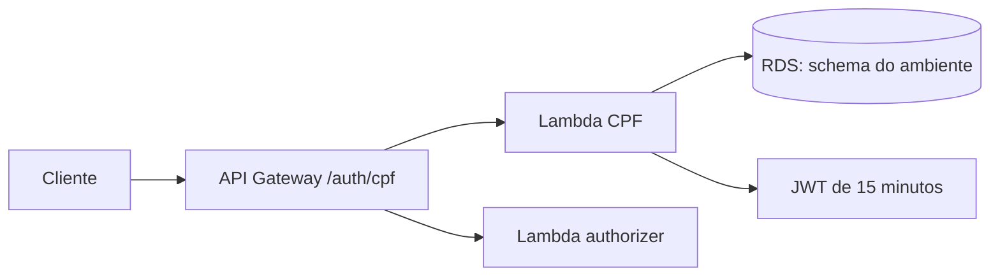

# Oficina Auth Lambda

Function Serverless de autenticação por CPF. O servidor Spring Boot continua disponível para desenvolvimento local; `CpfLambdaHandler` é o handler Java para AWS Lambda/API Gateway HTTP API. O Terraform em `aws/` foi aplicado e validado no AWS Academy Learner Lab em 23/10/2026; a infraestrutura é temporária e pode estar desligada após a janela de testes.

## Responsabilidade

1. Validar CPF; 2. consultar cliente `ATIVO` no PostgreSQL; 3. emitir JWT de 15 minutos com `sub`, CPF, papel, emissor e audiência.

## Local

```bash
mvn verify
```

O build gera `target/oficina-auth-lambda-0.1.0-SNAPSHOT-lambda.jar` (JAR sombreado de aproximadamente 23 MB). As classes dos handlers ficam na raiz do JAR, como exige o runtime Java da Lambda; o executável Spring para desenvolvimento local é gerado separadamente com classificador `exec`. CI e deploy verificam a presença de ambas as classes no pacote, impedindo regressão para layout `BOOT-INF`. O JAR contém o driver PostgreSQL. Os testes cobrem CPF ativo/inativo/inválido e o formato de resposta do handler. O handler não inicia Spring Boot: lê o evento HTTP API v2, consulta PostgreSQL privado e emite JWT. CPF e token não são registrados em logs de erro.

Com a API e o PostgreSQL locais ativos, execute na porta `8081` e use `POST /auth/cpf` com `{"cpf":"529.982.247-25"}`. Defina `SECURITY_JWT_SECRET` com pelo menos 32 caracteres; ela deve ser igual à secret da API.

## Infra AWS

`aws/` define Lambdas Java 17 de CPF para produção e homologação em VPC privada, authorizer JWT separado, API Gateway HTTP com `/auth/cpf`, `/homolog/auth/cpf` e integração privada para `/api/{proxy+}` em ambos os ambientes. O ALB interno do EKS fornece `backend_listener_arn`. O login administrativo tem rota pública própria; demais rotas privadas exigem JWT no gateway e a API repete a autorização por papel e posse. Há throttling no gateway e logs de um dia. No Learner Lab, use o `LabRole` preexistente; o módulo não cria IAM role.

Com `AWS_PROFILE=fiap-lab`, após `mvn verify`, forneça ao Terraform `TF_VAR_lambda_role_arn`, `TF_VAR_private_subnet_ids`, `TF_VAR_vpc_id`, `TF_VAR_lambda_security_group_id`, `TF_VAR_db_endpoint`, `TF_VAR_db_password`, `TF_VAR_jwt_secrets` (JSON com chaves `prod` e `homolog`, diferentes entre si) e `TF_VAR_lambda_artifact_path` pelo ambiente local. Cada chave JWT deve corresponder à API do **mesmo ambiente**; senha e chaves aparecem no Terraform state e precisam de armazenamento protegido. No GitHub, use `JWT_SECRETS_JSON` no environment `cloud` e `SECURITY_JWT_SECRET` distinta em cada environment da API. Use `terraform init -backend=false`, `terraform fmt -check` e `terraform validate` antes da ativação; `terraform plan` requer backend S3 e outputs reais de rede/RDS. **Não execute `apply`** antes de consolidar orçamento e dependências. O acesso JDBC privado e o `LabRole` foram validados na janela de 23/10/2026; precisam ser reconfirmados se a conta ou sessão mudar.

O workflow `deploy-aws.yml` prepara o apply da infraestrutura compartilhada em `main` e publica apenas o código das Lambdas de produção nessa branch. Um push em `homolog` publica apenas o código das Lambdas de homologação, sem aplicar o state compartilhado nem tocar em produção. O Terraform ignora mudanças de pacote após a criação inicial; releases de código usam `aws lambda update-function-code` (JAR atual de ~23 MB, abaixo do limite de upload direto de 50 MB) e aguardam a atualização. Primeiro aplique a infraestrutura por `main`, depois execute o release de `homolog`; um rollback de código requer republicar o artefato do commit anterior. Tudo continua condicionado a `ENABLE_CLOUD_DEPLOY=true` e credenciais temporárias no GitHub Environment `cloud`. Os [runs prod](https://github.com/ElizeuVicente/oficina-auth-lambda/actions/runs/39999149662) e [homolog](https://github.com/ElizeuVicente/oficina-auth-lambda/actions/runs/40000005381) passaram com AWS real, inclusive E2E de CPF ativo/inválido e isolamento dos JWTs. A gravação/PDF da Fase 3 permanecem pendentes; `soat-architecture` foi confirmado como colaborador dos quatro repositórios. Não declarar a entrega formal concluída apenas pelo JAR ou pelo `terraform validate`.

## Diagrama e contrato



Tecnologias: Java 17, AWS Lambda, API Gateway HTTP, JDBC/PostgreSQL, Terraform e GitHub Actions. Contrato: `POST /auth/cpf` (ou `/homolog/auth/cpf`) com `{"cpf":"..."}`; a [collection Postman](https://github.com/ElizeuVicente/fiap-tech-challenge/blob/main/postman/oficina-fase3.postman_collection.json) contém a chamada e variáveis sem dados reais. O Swagger do servidor local, quando iniciado, fica em `http://localhost:8081/swagger-ui.html`; a Lambda real não fornece Swagger próprio. Consulte também a [arquitetura integrada](https://github.com/ElizeuVicente/fiap-tech-challenge/blob/main/architecture/fase3-aws.md).
